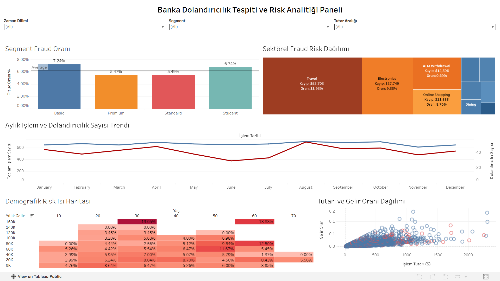

# Banka Dolandırıcılık Tespiti ve Risk Analitiği Paneli

Bu çalışma, bankacılık ve finansal hizmetlerde risk yönetimi süreçlerine veri odaklı bir yaklaşım getirmek ve analitik yetkinliklerimi pekiştirmek amacıyla hazırlanmış bir iş zekası projesidir. Proje kapsamında ham işlem verileri SQL ile modellenmiş, sektörel kayıplar ve anomaliler incelenmiş ve riskli demografik kümeler Tableau üzerinden görselleştirilmiştir.

---

### Canlı Panel ve Önizleme
Paneli Tableau Public üzerinden interaktif olarak inceleyebilirsiniz:  
[Tableau Public Dashboard Bağlantısı](https://public.tableau.com/views/BankaDolandrclkTespitiveRiskAnalitiiPaneli/BankaDolandrclkTespitiveRiskAnalitiiPaneli?:language=en-US&:sid=&:redirect=auth&:display_count=n&:origin=viz_share_link)

---

### Kullanılan Araçlar ve Depo Yapısı

* **Veri Hazırlama & Modelleme:** SQL (PostgreSQL / DBeaver)
* **İş Zekası & Görselleştirme:** Tableau Public
* **Depo Dosyaları:**
  * `fraud_analytics_data.sql` - Ham veriyi işleyen, risk gruplarını ve zaman dilimlerini hesaplayan veri hazırlama sorgusu
  * `fraud_analytics_data.csv` - SQL sorgusu sonucu elde edilen ve Tableau panosunu besleyen 8.000 satırlık nihai işlem veri seti
  * `dashboard_preview.png` - Panel önizleme görseli

---

### Dashboard Kapsamı ve Analitik Yapı

Panel, karar vericilerin hızlı filtreleme yapabilmesi ve operasyonel riskleri izleyebilmesi için yapılandırılmıştır:

* **Segment Analizi:** Temel müşteri segmentleri (Basic, Premium, Standard, Student) genelindeki dolandırıcılık oranlarını ve portföy ortalama risk eşiğini kıyaslar.
* **Sektörel Risk Dağılımı:** Harcama kategorilerindeki finansal kayıp hacmini ve fraud vaka oranlarını Treemap yapısıyla ilişkilendirir.
* **Aylık Hacim ve Vaka Trendi:** Çift eksenli zaman serisi üzerinden toplam işlem hacmi ile fraud vaka sayılarının dönemsel seyrini izler.
* **Demografik Risk Isı Haritası:** Yıllık gelir aralıkları ile yaş gruplarını kesiştirerek anomali gösteren risk kümelerini haritalandırır.
* **Tutar & Gelir Oranı Dağılımı:** İşlem tutarı ile müşteri gelir oranı arasındaki dağılım üzerinden aykırı (outlier) işlemleri tespit eder.

---

### Öne Çıkan Bulgular ve Risk Değerlendirmesi

* **Sektörel Risk Yoğunlaşması:** Seyahat ($53.7K kayıp, %11.93 oran) ve Elektronik ($27.7K kayıp, %9.38 oran) harcamaları, hem toplam finansal kayıp hem de vaka sıklığı açısından en yüksek riskli iki kategori olarak belirlenmiştir.
* **Sezonsal Sapma:** Toplam işlem hacmi yıl boyunca yatay bir seyir izlerken, dolandırıcılık vakalarında Ağustos döneminde belirgin bir tepe noktası gözlemlenmiştir.
* **Demografik Risk Kümeleri:** Isı haritası analizinde, özellikle 160K yıllık gelir bandındaki 30'lu yaş grubu (%19.05) ile 80K gelir bandındaki 60'lı yaş grubunda (%12.50) portföy ortalamasının üzerinde risk yoğunlaşması tespit edilmiştir.
